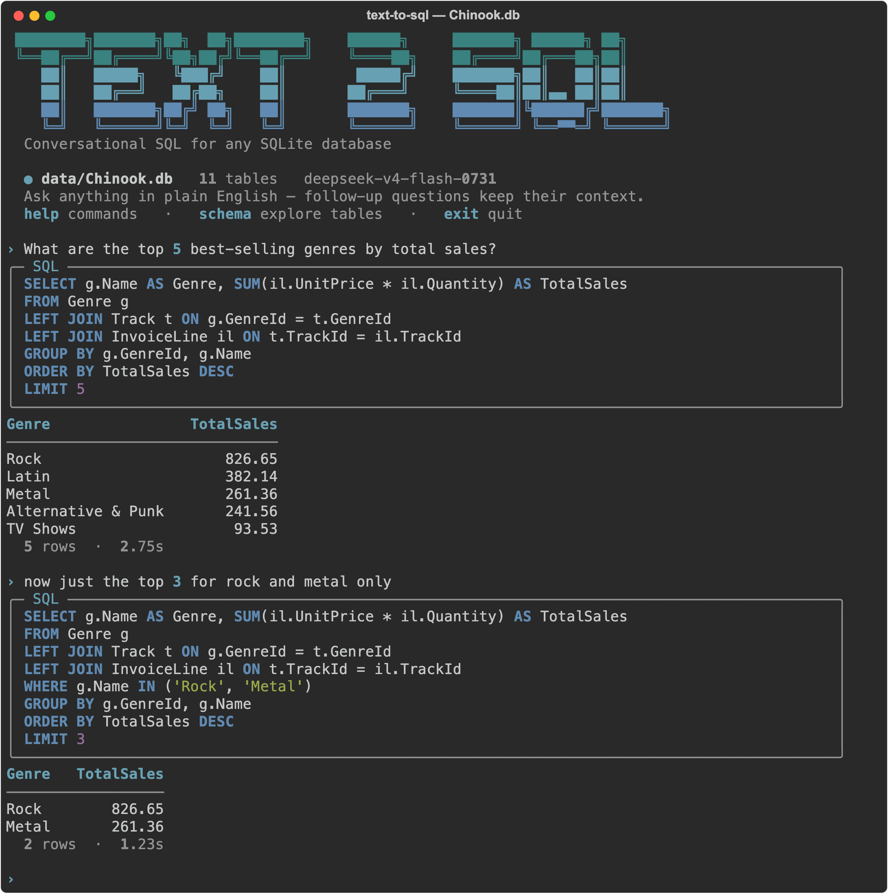

# Text-to-SQL CLI Agent

An interactive terminal agent that answers natural-language questions about a SQLite
database: it writes the SQL, runs it, and prints the rows. Built on an open-weight model
served by Fireworks.

**9/10 on the evaluation set at 1.15s median latency, against 1/10 for a naive
`"Convert this question to SQL"` prompt on the same model.**



## Quick start

### Prerequisites

| Need | Notes |
|---|---|
| [`uv`](https://github.com/astral-sh/uv) | `curl -LsSf https://astral.sh/uv/install.sh \| sh` |
| Python ≥ 3.11 | `uv` downloads a matching interpreter if you don't have one |
| A Fireworks API key | [fireworks.ai](https://fireworks.ai) — free credits are enough to run this |

`uv sync` installs every Python dependency from the committed `uv.lock`, so versions are
pinned and nothing else needs installing by hand.

### Run it

```bash
cd path/to/this/directory       # run everything from the project root
uv sync                         # installs pinned dependencies into .venv
cp .env.example .env            # then add your Fireworks API key
uv run cli
```

`data/Chinook.db` is included, so there is nothing to download. To rebuild it from the
upstream source instead, run `./setup.sh` (needs `curl` and `sqlite3`).

Run commands from the project root: the default database path (`data/Chinook.db`) is
relative, so `uv run cli` from elsewhere will not find it. Use `--db` with an absolute
path to query a database anywhere on disk.

### Environment variables

| Variable | Required | Default | Purpose |
|---|---|---|---|
| `FIREWORKS_API_KEY` | yes | — | Fireworks API key |
| `FIREWORKS_MODEL` | no | `accounts/fireworks/models/deepseek-v4-flash-0731` | any Fireworks model id |

Both are read from `.env` (via `python-dotenv`) or the environment.

### Running

```bash
uv run cli                      # or: python -m src.cli
uv run cli --db /path/to/other.db   # point at any SQLite database
```

Inside the session:

| Command | What it does |
|---|---|
| *(any question)* | Ask in plain English; follow-ups keep their context |
| `schema` | List tables, row counts, columns, and foreign-key relationships |
| `more` | Show every row of the last result |

Questions the database cannot answer are declined rather than guessed at, and input the
agent cannot interpret gets a request to rephrase instead of a guess — see
**Out-of-scope questions** below.
| `help` | Commands and example questions |
| `reset` | Forget the conversation so far |
| `exit` / `quit` | End the session (Ctrl-D also works) |

```
› What are the top 5 best-selling genres by total sales?

╭─ SQL ────────────────────────────────────────────────────────────────────────╮
│ SELECT g.Name AS GenreName, SUM(il.UnitPrice * il.Quantity) AS TotalSales    │
│ FROM Genre g                                                                 │
│ LEFT JOIN Track t ON g.GenreId = t.GenreId                                   │
│ LEFT JOIN InvoiceLine il ON t.TrackId = il.TrackId                           │
│ GROUP BY g.GenreId, g.Name                                                   │
│ ORDER BY TotalSales DESC                                                     │
│ LIMIT 5                                                                      │
╰──────────────────────────────────────────────────────────────────────────────╯
 GenreName            TotalSales
 ───────────────────────────────
 Rock                     826.65
 Latin                    382.14
 Metal                    261.36
 Alternative & Punk       241.56
 TV Shows                  93.53

  5 rows  ·  1.42s
```

SQL is highlighted using only the terminal's own colour palette — identifiers keep the
default foreground, so the output stays legible on light and dark terminals alike (a fixed
syntax theme renders near-white identifiers invisible on a white background). The query
panel is capped at 96 columns so a maximised terminal doesn't stretch one query across the
full width. Numeric columns are right-aligned with thousands separators,
`NULL` renders as `—`, and a spinner runs while the model works so a slow query never
looks like a hang. `more` prints straight to the terminal rather than handing off to
`less`, so the session never leaves the CLI. When a repair adds a round-trip the spinner says so
(`Query failed — repairing (attempt 2 of 3)…`) and the footer records it afterwards
(`self-repaired after 1 failed attempt`) rather than hiding it. Results are capped at 20
rows on screen with the true count always reported; `more` pages through all of them.

Follow-ups resolve against the conversation — asking *"now just the top 2 for 2021"* next
reuses the aggregation and adds the date filter.

### Evaluation

```bash
uv run python -m src.eval              # score against the 10 dev questions
uv run python -m src.eval --baseline   # also run the naive baseline prompt
```

Writes `dev_answers.json` (generated SQL plus a readable summary for each question).

## Results

Measured on the 10 dev questions. **9/10 in 5 consecutive runs**; q_003 fails every
time (see limitations). One earlier run scored 8/10 when q_004 returned a single
column instead of two — temperature-0 output is not fully deterministic, which is
itself a documented limitation rather than a rounding detail.

| | This agent | Naive baseline |
|---|---|---|
| Accuracy | **9/10** | **1/10** |
| Tier 1 (simple) | 3/4 | — |
| Tier 2 (joins/aggregates) | 4/4 | — |
| Tier 3 (window/HAVING) | 2/2 | — |
| Latency P50 | **1.15s** | — |
| Latency P95 | 5.24s | — |
| Tokens per query | ~823 (772 in / 52 out) | — |

The baseline is the naive prompt (`Convert this question to SQL: {question}`)
run against the same model, so the comparison isolates the agent design rather than the
model choice. Its typical failure is inventing table names — it reached for `genres` and
`invoice_items`, which belong to a *different* Chinook naming convention than this
database uses.

## Cost

Token usage measured across the 10 dev questions (772 input / 54 output per query),
priced at published rates for each provider at a reference workload of 30,000
queries/day (1,000 active users asking 30 questions each).

**Against proprietary alternatives**, running this same agent architecture:

| Model | Input $/M | Output $/M | Per month | Per year | vs Fireworks |
|---|---|---|---|---|---|
| **DeepSeek-V4-Flash (Fireworks)** | $0.22 | $0.66 | **$187** | **$2,248** | — |
| gpt-5.4 | $2.50 | $15.00 | $2,498 | $29,954 | 13.3x |
| gpt-5.4-mini | $0.75 | $4.50 | $749 | $8,986 | 4.0x |
| gpt-5.4-nano | $0.20 | $1.25 | $202 | $2,426 | 1.1x |

That is **$27,706/year saved at that volume** against the frontier tier. The sharper
version: a naive prompt is cheap *because* it is broken — with no schema card the prompt
is ~15 tokens, so it runs ~$770/month and answers 1 question in 10. Fixing quality
requires schema grounding, which multiplies input tokens ~50x; on gpt-5.4 that lands at
$2,498/month. The same fix on Fireworks is $187/month — **less than a quarter of the
cost of the broken prototype it replaces.**

**Configuration matters as much as vendor:**

| Configuration | Per 1k queries | Per month | Per user/month |
|---|---|---|---|
| Reasoning on, no caching | $0.55 | $502 | $0.50 |
| **Reasoning off — as shipped** | **$0.21** | **$187** | **$0.19** |
| Reasoning off + prompt caching | $0.04 | $40 | $0.04 |

Two things drive this:

**Disabling reasoning removes 63% of total spend.** Completion tokens drop 10.7x — 575 to
54 per query — because the model stops emitting hidden chain-of-thought. Output is priced
3x higher than input, so this is the dominant term. It also removes a failure mode: with
reasoning on, one of the ten questions exhausted the 2048-token budget and returned no SQL
at all.

**The prompt is 98% cacheable.** The system prompt plus schema card is a fixed 757-token
prefix; the question itself averages only 15 tokens. Cached input is priced 31x below
uncached, so a warm prefix takes the bill from $187/mo to ~$40/mo. That figure is an
**upper bound on the saving, not a promise** — see limitations below.

**Where this argument is weakest:** gpt-5.4-nano lands at $202/month, essentially parity.
On price alone the smallest proprietary tier is competitive, and claiming an
order-of-magnitude win against *every* alternative would be overstating it. The case
against nano is quality at that price point (unmeasured here, and small models degrade
fastest on the tier-3 window-function questions) plus the optionality an open-weight model
keeps — fine-tuning on execution-result reward, self-hosting at steady volume, and no
exposure to unilateral pricing changes.


## How it works

A single LLM call on the happy path, with a repair loop behind it.

```
question ──> [ system prompt + schema card + history ] ──> SQL ──> execute
                          ^                                          │
                          └────────── error fed back ────────────────┘  (up to 2 retries)
```

**Schema grounding.** `build_schema_card()` reads the live schema — tables, columns with
types, primary keys, and every foreign-key edge — and injects it into the system prompt.
The FK edges are the part the naive prompt is missing: without them the model guesses at
joins. The card is built once per session from the connected database, so pointing the
CLI at a different database needs no code change.

**Execution-guided self-repair.** Generated SQL is executed immediately. If SQLite
rejects it, the error text and the failed query go back to the model, which gets up to two
more attempts. Execution is the validator — a query that runs and returns rows is worth
more than one that parses. Failed attempts are not written into conversation history.

**Conversation context.** Successful `(question, SQL)` turns are kept, capped at the last
four, so follow-ups work without re-stating the question.

**Read-only enforcement.** Model output is stripped to a single statement, then rejected
unless it is a lone `SELECT`/`WITH` with no write keywords. Anything after the first
semicolon is discarded before execution, so a trailing `DROP TABLE` cannot run.

**Out-of-scope questions.** Asked *"what is the capital of Nigeria?"*, an unguarded
text-to-SQL agent will happily emit `SELECT 'Abuja' AS CapitalOfNigeria`. That executes
cleanly and renders in the results table looking exactly like data from the connected
database — model knowledge laundered into something indistinguishable from a real answer.
For a BI tool that is the worst available failure, so it is blocked in two layers:

1. **The model is asked to decline**, returning the sentinel `NOT_A_DATA_QUESTION` for
   anything the schema cannot answer. One call, no extra latency, ~63 tokens.
2. **A structural backstop** rejects any query that reads from no table in the schema
   (`references_known_table`). A question *about the data* must read the data, so a query
   touching no table cannot be answering one. This needs no cooperation from the model,
   and it fires before execution — so a laundered answer is never even run.

**Unclear input is a third state.** A stray word — `rest`, `quest`, `ok` — is neither a
data question nor a general-knowledge one, and the model's instinct is to answer it by
silently re-running the previous query. That is worse than it sounds: the user gets a
plausible table with no indication their input was never understood. Two mechanisms:

1. **A prompt rule** requiring every message to name an entity, metric, or filter, and
   stating explicitly that repeating the previous query is never a valid response to a
   message the model doesn't understand.
2. **A deterministic backstop** (`SQLAgent._repeats_last_query`) comparing the generated
   SQL against the previous turn's. If they are identical, the turn is rejected. This
   needs no cooperation from the model, and its false-positive case is benign: a user who
   genuinely re-asks the same question is told it is the query they just ran.

The CLI answers with "Not sure what you mean" and a prompt to rephrase — deliberately
different from the out-of-scope panel, since telling someone their typo is "outside this
database" is confusing. The failure there is comprehension, not scope.

Measured across three runs — 20 in-scope questions (the 10 dev questions plus 10 others),
10 out-of-scope questions, 24 stray inputs inside live conversations, 12 real follow-ups
and 15 terse-but-real questions — **0 false positives and 0 false negatives on that set**.

That last qualifier is load-bearing. In ad-hoc use, *"how many albums did Iron Maiden
sell?"* was declined as out-of-scope. Two separate causes, both since fixed:

1. **The scope rule was over-broad.** Chinook records *track* purchases, not album
   purchases, so "albums sold" has no direct mapping and the model treated an ambiguous
   *metric* as an out-of-scope *question*. The rule now says to decline only what has no
   connection to the data, and to pick a reasonable interpretation when the entities are
   in the schema but the metric is ambiguous. Reproduced 3/3 before, 0/3 after.
2. **The repeat-detection backstop misfired.** Asking *"how many albums did this band
   sell?"* and then the explicit *"how many albums did Iron Maiden sell?"* produces
   identical SQL by design — a user resolving their own pronoun — and the backstop
   rejected the second as a meaningless repeat. It is now scoped to messages of three
   words or fewer, which is what stray input actually looks like.

Both were found by a user exercising the CLI, not by the test set — which is the point.
A guard measured against author-written examples will understate its false-positive rate.
The trade-off is deliberate: wrongly declining a good question costs the user a rephrase,
while wrongly answering an out-of-scope one presents invented data as though it came from
their database.

The follow-up cases matter most: `now just for 2021` and `what about more than 2?` are
also short and context-dependent, and an over-eager rule would reject them. The sentinel catches every case in practice;
the backstop exists for when a model ignores the instruction, which is precisely what
happened before the rule existed. Declined turns never enter conversation history — without
that, `SELECT 'Abuja'` leaked into the next question's context and corrupted it.

## Design decisions

**Grade by result, not by SQL string.** Many different queries answer the same question,
so `src/eval.py` executes the generated SQL and compares the rows to the gold result. The
comparison is an order-insensitive multiset (several dev questions have ties whose
ordering is unstable, but duplicate rows must still match) with floats rounded to cents.
Where the agent returns extra columns, the gold columns must all be present and correct;
column names are matched first, falling back to position.

**Disable reasoning.** The default model is a reasoning model. On this task the hidden
chain-of-thought is wasted work: setting `reasoning_effort="none"` cut median latency from
6.15s to 1.20s and completion tokens roughly 10x, with no accuracy change. This is what
takes the CLI from sluggish to interactive. `SQLAgent` falls back automatically if a model
does not accept the parameter.

**No framework.** The OpenAI SDK against the Fireworks endpoint is the whole client. For
11 tables the schema fits comfortably in the prompt, so there is no retrieval step and no
agent framework to reason about.

## Known limitations

Where this would need work before it ships:

1. **Valid SQL can still be the wrong answer, and nothing catches it.** Execution-guided
   repair converts crashes into answers; it is blind to a query that runs cleanly and
   returns the wrong rows. One *cause* was found and fixed (see **A bug this surfaced** below), but the
   class of failure is undetectable by the agent. The mitigation is that the SQL is always
   displayed, so a reader can catch what the system cannot.

2. **q_003 fails on presentation, not logic.** For *"names and email addresses of
   customers from Brazil"* the agent returns `FirstName || ' ' || LastName` as one column
   where the gold answer keeps them separate. The rows are correct; the shape differs. The
   underlying issue is that the question is ambiguous about output shape and nothing
   anchors the agent to one reading.
3. **Some prompt rules were derived from the answer key.** The output-shape rules ("do not
   return id columns", "one display-name column when asked *which* person") were added
   after seeing how gold results are formatted, and moved the score from 8/10 to 9/10.
   They are defensible as BI product behaviour, but they are fitted to this dev set and
   should be re-validated against held-out questions.
4. **Ten questions is not an evaluation.** It is a smoke test. Single-digit differences
   here are not statistically meaningful.
5. **Conversation handling is not covered by the eval at all.** The harness calls
   `agent.reset()` before every question, so all ten are scored as independent
   single-turn requests — deliberately, since the dev questions are not a conversation
   and carrying history between them would make the score depend on question order.
   The consequence is that follow-up resolution, a core CLI feature, has no automated
   test. It is verified only by hand. A multi-turn eval set — a seed
   question plus scripted follow-ups with their own gold results — is the fix.
6. **Tail latency is unstable.** P50 is consistently ~1s, but one run of a trivial query
   took 25.8s and did not reproduce. Serverless inference has a real tail; a P95 SLO needs
   many more samples and probably dedicated capacity.
7. **Output varies run to run even at `temperature=0`**, occasionally producing a
   near-empty completion. The repair loop covers this, at the cost of an extra round-trip.
8. **Schema grounding does not scale by inlining.** At ~770 prompt tokens the Chinook card
   is cheap. A warehouse with thousands of tables needs schema retrieval instead.
9. **The cached-cost figure assumes cache hits.** Prompt caching is priced per warm
   prefix, and in this product each tenant has a different schema, so the prefix is not
   shared across customers. Low-frequency users may never hit a warm cache; $40/mo is the
   ceiling of the saving, not the expected value.
10. **No guard on result size or query cost.** A generated `SELECT *` over a large table
   would happily run. Display is capped at 20 rows; the query is not.

## Correct SQL, misleading answer

Asked *"which song sold the most in 2024?"* the agent returned one track name. The SQL was
correct; the answer was misleading. `InvoiceLine.Quantity` is `1` for all 2,240 rows in
Chinook — every line item is a single track purchase — so 447 tracks tie for "most sold in
2024" and `LIMIT 1` picks an arbitrary winner. Nothing errors, and the query faithfully
implements the question; the question has no unique answer.

The fix is general rather than dataset-specific: **a superlative must return the value it
ranked by**. "Fast As a Shark" tells you nothing; "Fast As a Shark, 1" tells you instantly
that the question is ill-posed. Dev-set accuracy is unchanged at 9/10 across three runs.

Detecting the tie and *saying so* is a different problem, and deliberately not solved here
— special-casing ties in the prompt would fit one dataset's quirk rather than the class. It
needs a component that checks returned rows against the question's intent, which is the QA
stage of the multi-agent design under "What I would do next".

## A bug this surfaced: retry prompts redefine the task

Asking for artists in more than 2 genres (7 rows), then *"restrict to those whose name has
two words"*, returned 76 artists instead of 5 — valid SQL, clean execution, wrong answer.
The turn had self-repaired twice, so every internal signal reported success.

Ablation isolated the cause, and it was **not** follow-up handling — conversation history
did contain the earlier query and its `HAVING` clause. Six runs per condition:

| Condition | Constraint kept |
|---|---|
| Clean context, first attempt | 6/6 |
| After two repair rounds | **0/6** |
| After two repair rounds, goal restated | 6/6 |

The repair message read:

```
That query failed with: {error}
Return a corrected SQLite SELECT statement, nothing else.
```

That is the most recent instruction in the conversation, so it silently redefines the task
as *fix this syntax error* — the original question is by then several messages back. The
model repaired the broken SQL, which had already lost the constraint, without revisiting
what was asked. The fix adds one line:

```
Fix it so that it answers this question: {question}
```

Same scenario, 6/6. The generalisable lesson for anyone building a retry loop over an LLM:
**the retry prompt becomes the task definition**, so it has to carry the goal, not just the
error.

A separate prompt rule about carrying filters forward was also tried and then *removed* —
measured 6/6 without it against 5/6 with, for ~59 tokens on every call. Ablate before
believing a prompt fix.

## What I would do next

- **Validate prompt-cache hit rates per tenant.** The 757-token prefix is 98% of input and
  cached input is 31x cheaper, but each customer database has its own schema and therefore
  its own prefix. A user asking 30 questions a day touches their prefix once every ~48
  minutes, which may be too sparse to stay warm. Worth measuring real hit rates before
  promising the $40/mo number.
- **Grow the eval set** beyond 10 questions, with held-out questions the prompt was never
  tuned against, and track accuracy by tier over time.
- **Fine-tune a smaller model** on execution-result reward. The task is narrow and the
  reward signal is free — the query either returns the right rows or it does not.
- **Query guardrails**: statement timeouts, row limits, and cost estimates before
  execution.
- **Read-only database connections** as defence in depth, rather than relying on the SQL
  guard alone.

## Project layout

```
src/agent.py   schema card, generation, repair loop, read-only guard
src/cli.py     interactive REPL — control flow only
src/ui.py      all terminal rendering (banner, SQL panel, tables, errors)
src/eval.py    result-match scoring, baseline comparison, writes dev_answers.json
src/utils.py   SQLite helpers
dev_answers.json  generated output for the 10 dev questions
```

Presentation is kept out of logic: `agent.py` knows nothing about a terminal and
`cli.py` holds no agent logic, so a `--json` or `--quiet` mode would touch only `ui.py`.

Dependencies stay deliberately small — the OpenAI SDK pointed at Fireworks, pandas for
result frames, python-dotenv for config, and `rich` for rendering. `rich` earns its
place by *reducing* code: hand-rolling ANSI colour, table layout and a spinner would be
~150 lines of presentation logic instead of ~40. No agent framework, no vector store,
no retrieval layer.

## AI assistance

Built with Claude Code (Claude Opus). I directed the design decisions — schema card
contents, the repair loop, result-match evaluation, and the accuracy/latency trade-offs —
and used it to write and iterate on the implementation. The reasoning-token finding and
the `pandas.errors.DatabaseError` bug in the repair loop both surfaced while debugging
failing eval runs together.
